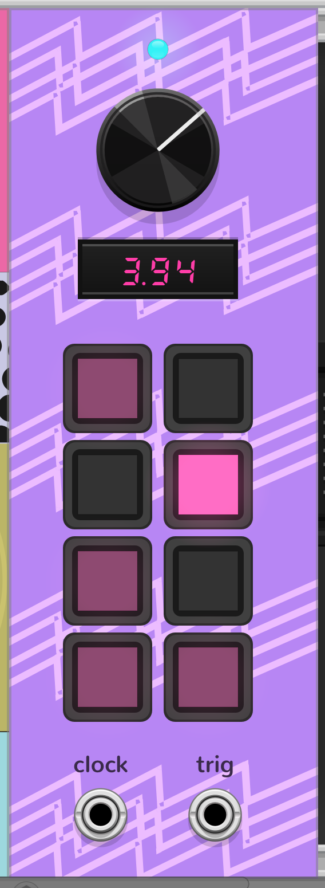

```text
██████╗ ██████╗ ███████╗ █████╗ ███╗   ███╗ ██████╗ █████╗  ██████╗██╗  ██╗███████╗
██╔══██╗██╔══██╗██╔════╝██╔══██╗████╗ ████║██╔════╝██╔══██╗██╔════╝██║  ██║██╔════╝
██║  ██║██████╔╝█████╗  ███████║██╔████╔██║██║     ███████║██║     ███████║█████╗
██║  ██║██╔══██╗██╔══╝  ██╔══██║██║╚██╔╝██║██║     ██╔══██║██║     ██╔══██║██╔══╝
██████╔╝██║  ██║███████╗██║  ██║██║ ╚═╝ ██║╚██████╗██║  ██║╚██████╗██║  ██║███████╗
╚═════╝ ╚═╝  ╚═╝╚══════╝╚═╝  ╚═╝╚═╝     ╚═╝ ╚═════╝╚═╝  ╚═╝ ╚═════╝╚═╝  ╚═╝╚══════╝
```

A VCV Rack module developed by Dreamcache

----------------------------------------------------------------------------------

*-Overview-*

D R E A M C A C H E is an 8-step gate/trigger sequencer designed around a single idea:

xx Pattern as pulse xx

Large latch pads, a free-running clock, and two clean outputs — clock every step, trigger only on hits.

----------------------------------------------------------------------------------

*-Features-*

– Internal clock with rate knob and Hz display
 • Range ~0.25–16 Hz (1 V/oct style: rate = 2^pitch)
 • Cyan clock light above the knob

– 8 large square step pads in a 2×4 grid
 • Latch on/off per step
 • Pink step lights: bright on active hit, dim on active rest, soft glow when armed

– Outputs
 • clock — rising pulse on every step advance
 • trig — rising pulse only when the current step is on (off steps are rests)

Designed for fast pattern sketching and classic rest-aware sequencing

----------------------------------------------------------------------------------

*-Installation-*

Build from source (Rack SDK Makefile)

1. Clone this repository:
   git clone https://github.com/armedstar/Dreamcache.git
   cd Dreamcache

2. Point Make to your Rack SDK location:
   export RACK_DIR=/path/to/Rack-SDK

3. Build and install:
   make
   make install

4. Restart VCV Rack.

Add **Dreamcache / Dreamcache** from the module browser.

----------------------------------------------------------------------------------

*-Module-*



~9 HP panel · clock knob · Hz display · 8 latch pads · clock + trig outs

----------------------------------------------------------------------------------

*-License-*

MIT License

----------------------------------------------------------------------------------

*-Author-*

Dreamcache (https://github.com/armedstar)
